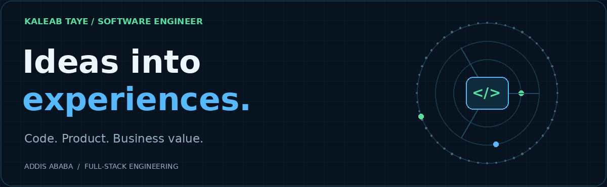
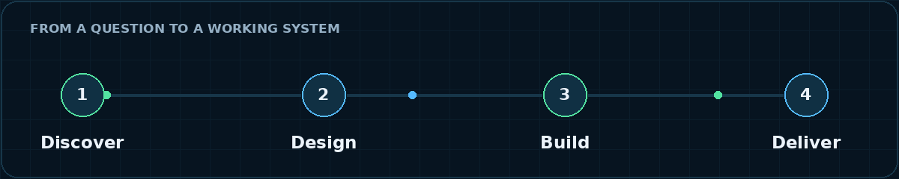
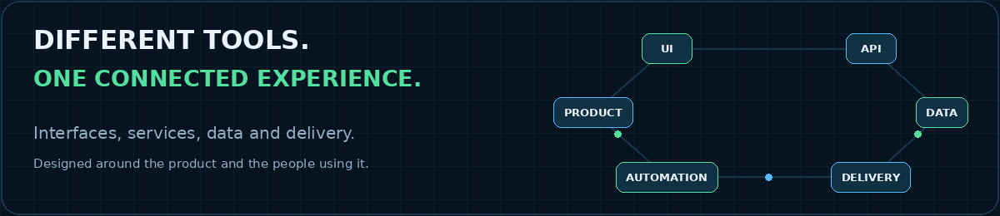

<picture>
  <source media="(prefers-reduced-motion: reduce)" srcset="./assets/hero-static.png">
  
</picture>

# Kaleab Taye

**Full-stack software engineer. Playful by design. Useful by purpose.**

I build products that connect thoughtful interfaces with reliable systems. My work spans web and mobile experiences, APIs, infrastructure and business automation — with an eye for the details that make complex software feel effortless.

[Explore my portfolio](https://kaleab-taye.dev) · [GitHub work](https://github.com/kaleab-taye-luxodd?tab=repositories) · [LinkedIn](https://www.linkedin.com/in/kaleab-taye/) · [Get in touch](mailto:kaleabtaye@gmail.com)

## What I’m building around

- **Products with a pulse.** Currently building with GUGS Games and Luxodd Games; explore the work and my contributions in the [portfolio case studies](https://kaleab-taye.dev/#work).
- **Software that connects the whole picture.** Interfaces, services, data and delivery designed around an actual product need.
- **Everyday work, made better.** Business workflows, automation and interactive experiences that help people get things done.

<picture>
  <source media="(prefers-reduced-motion: reduce)" srcset="./assets/workflow-static.png">
  
</picture>

## Across the stack

| Experiences | Systems | Delivery & operations |
|---|---|---|
| TypeScript · JavaScript | Node.js · Go · Python · .NET | AWS · Azure · Docker |
| React · Next.js · Vue | REST · GraphQL · gRPC | Git · GitHub · CI/CD |
| Flutter · HTML · CSS | PostgreSQL · MongoDB · MySQL | Power Apps · Power Automate · SharePoint |
| UI motion · accessibility | APIs · integration · data flows | Product thinking · workflow automation |

Tools are part of the work. The aim is a clear, reliable experience for the person on the other side of the screen.

<picture>
  <source media="(prefers-reduced-motion: reduce)" srcset="./assets/systems-static.png">
  
</picture>

## Work worth exploring

| Area | Explore |
|---|---|
| **Portfolio & engineering journey** | [kaleab-taye.dev](https://kaleab-taye.dev) — project stories, professional work, skills and résumé. |
| **Games & playful experiences** | [Selected work](https://kaleab-taye.dev/#work) with GUGS Games and Luxodd Games, including product and engineering contributions. |
| **Business systems & automation** | [The broader picture](https://kaleab-taye.dev/#about) — interfaces, integrations and workflows that turn a brief into a working system. |
| **Public portfolio source** | [kaleab-taye-portfolio](https://github.com/kaleab-taye-luxodd/kaleab-taye-portfolio) — the published portfolio’s production files. |

I also explore immersive desktop experiences, precise interaction design and performance-conscious visual tools. Public repositories are a selection of my work; the portfolio gives the wider context. GitHub’s contribution calendar below this README shows this account’s current activity.

## The person behind the build

Based in **Addis Ababa, Ethiopia**. BSc in Software Engineering, **AAIT / Addis Ababa University, class of 2023**. Co-founder of **Qmem Developers**. Curious about how engineering, design and business fit together — and how a useful idea becomes something people enjoy using.

**Have a product to build, a workflow to untangle or an experience to improve?** [Let’s talk.](mailto:kaleabtaye@gmail.com)

Original blue-and-green motion artwork, hosted in this repository. Reduced-motion browsers receive still images; all written content remains available without animation. No profile-view trackers or third-party statistics widgets.
